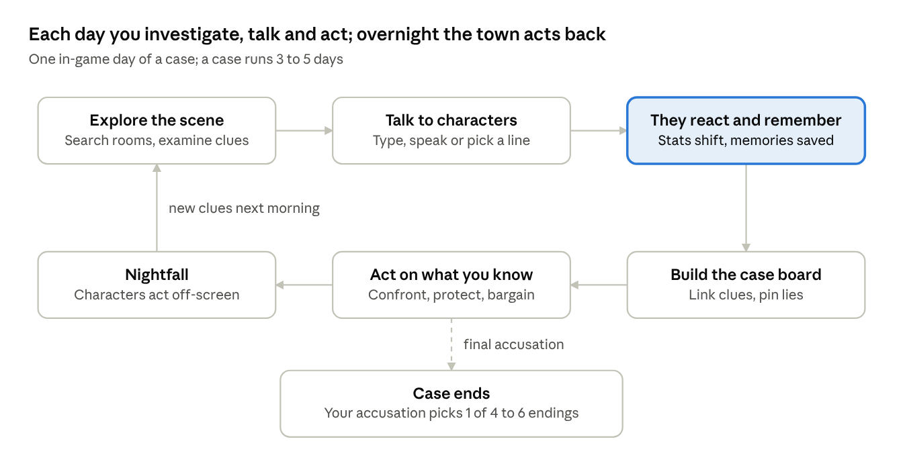
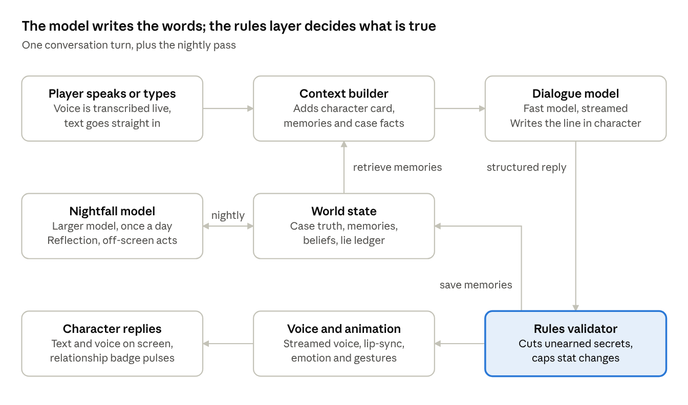
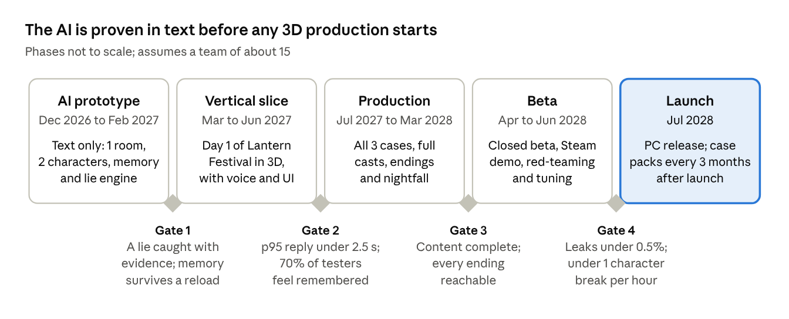

# PRD — Everyone Remembers (working title)

Last updated: Nov 5, 2026 · Editable version: [Claude doc](https://claude.ai/artifact/UZRprFE8RjbV9DpXRWWCHi)

## Overview and vision

**Everyone Remembers** is a stylized 3D detective game where every character runs on an AI brain: a fixed personality, a lasting memory of you, and secrets of their own. What you say, and how you treat people, permanently reshapes each case.

**The fantasy:** you are the detective in a town where nobody forgets. You talk to people in your own words (typed, spoken, or picked from suggestions). They remember it, gossip about it, lie to protect themselves, and turn on you if you push too hard.

### Design pillars

1. **They remember.** Every promise, threat, gift and accusation is stored and comes back, sometimes days later, sometimes from someone else.
2. **They have their own minds.** Each character has goals, fears and a schedule, and acts on them when you are not looking.
3. **Authored truth, improvised voice.** Writers fix what actually happened in each crime. The AI decides how people talk, never what is true, so every case stays solvable.
4. **Truth is earned.** Lies are caught through evidence, contradictions and cross-checking, not a lie meter.
5. **Consequences stick.** Relationships cannot be undone by reloading. The story bends around your choices.

### What we take from the reference screenshots

The two supplied screenshots (from *Fire Emblem: Three Houses* and *Metaphor: ReFantazio*, in [`/design`](../design)) set the presentation conventions we adopt. We build our own characters, art and UI frames; we borrow conventions, not the look.

- Conversations play inside the live 3D scene, not on a black screen.
- A large character bust sits beside a name-plated dialogue box.
- A relationship badge on a mini-portrait shows when someone's feelings change.
- Choice lines can show their relationship effect (an icon and a value).
- A slim control row offers Log, Auto-advance and Hide UI.

## Target players and opportunity

The core audience is narrative and mystery players aged 18 to 35 who already love relationship systems and detective puzzles, but have never had characters who truly respond to them.

| Segment | Who they are | What they want from us |
| --- | --- | --- |
| Primary: mystery and story fans | Play detective games, visual novels and relationship-driven RPGs | A real case to crack, characters with depth, choices that matter |
| Secondary: streamers and creators | Build content around unique moments | Conversations no other player will ever get, clip-able betrayals |
| Tertiary: AI-curious players | Have tried AI chat companions | A game with goals and stakes, not an open-ended chatbot |

**Why now:** language-model latency and cost have dropped enough for real-time character dialogue. Players have shown they enjoy talking freely to AI characters, but most attempts so far are short experiences or tech demos. The opening is a full game: authored mysteries, production-quality 3D, and memory that lasts.

### Competitive landscape

| Game or category | What it does well | What we add |
| --- | --- | --- |
| *Ace Attorney* series | Catching lies by presenting evidence | Witnesses who answer in their own words and remember how you treated them |
| *L.A. Noire* | Reading faces during interrogations | Free conversation instead of three fixed responses |
| *Disco Elysium* | Deep, reactive written dialogue | Dialogue that is generated live, so no two playthroughs match |
| *Fire Emblem: Three Houses*, *Persona*, *Metaphor: ReFantazio* | Relationship stats and bonds | Relationships driven by what you actually say, including betrayal |
| AI-NPC games and demos (e.g. *Vaudeville*, *Suck Up!*) | Proved players enjoy talking to AI characters | Long-term memory, authored solvable cases, consequences across days and cases |

Comparisons are from general knowledge and are approximate; validate before external use.

## Goals, non-goals and success metrics

Version 1.0 ships three complete cases on PC, each with 6 to 8 AI characters and 4 to 6 hours of play, where players reliably feel remembered and every case can be solved by evidence.

### Goals

- Ship 3 launch scenarios and 4 playable detective archetypes.
- Make memory visible: characters bring up past actions without being asked.
- Keep every case solvable no matter how the AI words things.
- Make each case replayable with a different detective or approach.

### Non-goals for 1.0

- Open-world sandbox. Each case is a contained 3D location.
- Multiplayer.
- Fully AI-generated mysteries. Crimes and clues are authored.
- User-created scenarios (planned post-launch).
- Photoreal graphics. We target stylized, cel-shaded 3D.

### Success metrics

| Metric | Target | How we measure |
| --- | --- | --- |
| Players who say a character remembered something they did | ≥ 70% | Post-session survey |
| Time to first character reply (text or voice) | p50 < 1.0 s, p95 < 2.5 s | Client telemetry |
| Out-of-character breaks | < 1 per hour of play | Automated evals + player reports |
| Secrets leaked without their trigger | < 0.5% of conversations | Rules-layer logs |
| Case completion rate | ≥ 60% of players who start a case | Telemetry |
| Players who replay a case differently | ≥ 30% | Telemetry |
| AI cost per player-hour | ≤ $0.05 | Billing / telemetry |
| Steam review score | ≥ 85% positive | Steam |

## Core gameplay loop

A case runs over 3 to 5 in-game days. Each day the player explores, talks, builds the case and acts; at nightfall the characters act back.

The highlighted step is what sets the game apart: every conversation shifts stats and leaves memories that change every step after it.

### Player verbs

| Verb | Example | Risk |
| --- | --- | --- |
| Ask | "Where were you at eleven?" | None, but people notice what you ask about |
| Present evidence | Show the IOU to Mira | Burns the clue if shown to the wrong person |
| Promise | "I won't tell the captain." | Breaking it costs Trust with everyone who hears |
| Threaten | "Your grandson was on that boat." | Fear rises, Trust falls, betrayal triggers |
| Flatter or comfort | Praise Sora's music | Seen through by sharp characters |
| Lie or bluff | Claim you already know the truth | Caught lies cost Trust and Respect |
| Give a gift | Bring Teodor tobacco | Low; builds Affection slowly |
| Trade information | Tell Inés what Ruel said | The information spreads further |
| Tail or eavesdrop | Follow Sora after dark | Being spotted costs Trust |

### Session shape

- One in-game day takes about 45 to 60 minutes of play.
- Every conversation and search costs time, so the player cannot question everyone every day.
- The day ends at nightfall (see Consequence and narrative system).

## AI character system

Each character is an authored character card plus a live memory, read by a language model that writes their lines and a rules layer that decides what they are allowed to reveal.

### Character card (authored by writers)

| Field | What it holds | Example |
| --- | --- | --- |
| Identity | Name, age, job, look, voice | Mira Hal, 52, innkeeper |
| Personality | Five trait sliders (openness, conscientiousness, extraversion, agreeableness, neuroticism), values, temper | Warm, nosy, quick to forgive, slow to forget |
| Speech style | Vocabulary, rhythm, verbal tics, 5 to 10 sample lines | Calls everyone "love", changes subject when nervous |
| Goals and fears | What they want this week; what they will protect | Keep the inn; hide her debt |
| Knowledge | Case facts they know, half-know or wrongly believe (by fact ID) | Saw the victim leave at 11 pm |
| Secrets | Hidden facts, each with reveal conditions | Lent the victim money; reveals if Trust ≥ 40 or shown the IOU |
| Lie policy | What they lie about, how well, and when they crack | Lies smoothly about money; cracks under evidence |
| Relationships | Feelings toward every other character | Protective of Teodor; resents the police chief |
| Schedule | Where they are at each hour of the day | Bar 6 pm to midnight |

### Memory: three layers

1. **Working memory:** the current conversation, verbatim.
2. **Episodic memory:** short, dated summaries of events involving the player, each scored for importance and emotion. Example: "Day 2: the detective accused me of theft in front of Sora. Humiliated." The most relevant, recent and important memories are pulled into each conversation.
3. **Beliefs:** what the character concludes about the player and the world ("The detective cannot be trusted with secrets"). Beliefs are rewritten each night in a reflection pass.

**Gossip:** characters share memories with people they trust. Insult the innkeeper and her friends will treat you coldly by morning. Information spreads along the relationship web, so a secret told to the wrong person can reach the culprit.

Memory lives in the save file. Recurring characters carry it into later cases.

### Relationship stats

Each character tracks four values toward the player, from -100 to +100.

| Stat | Rises when you | Falls when you | Unlocks |
| --- | --- | --- | --- |
| Trust | Keep promises, protect secrets, tell the truth | Lie and get caught, break confidences | Secrets, alibis, warnings |
| Affection | Show kindness, remember personal details, give gifts | Mock, ignore, endanger them | Favors, personal side stories |
| Fear | Threaten, show authority, reveal damaging evidence | Back off, show weakness | Fast confessions, but also flight or sabotage |
| Respect | Reason well, catch lies, stay calm | Make wrong accusations, act erratically | Cooperation from proud or powerful characters |

### Lies and betrayal

- Every case fact has a true state held by the game. When a character speaks about a fact, they **reveal, withhold or lie**, based on their goals, their stats toward you and the pressure on them.
- Every lie is written to a hidden **lie ledger**. The game can then confirm when the player catches one.
- Players catch lies by presenting contradicting evidence, cross-checking with other witnesses, and noticing tells (hesitation in voice, nervous animations driven by a stress value).
- **Betrayal** is authored as triggers. Example: if Trust < -30 and the player threatens someone the character protects, they tip off the culprit, destroy a clue or sell the player out to the police.

### Guardrails: authored truth, improvised voice

- The model never decides facts. Each reply is structured data: the spoken line, emotion, animation, facts revealed, lies told, relationship changes and memories to store.
- The rules layer checks every reply. A fact whose reveal conditions are not met is cut. Stat changes are capped per turn.
- Attempts to break the fiction ("ignore your instructions") are answered in character: "I don't follow, detective."
- If the model is slow or fails, the character uses an authored fallback line or idle reaction.

### How players talk

- **Free input:** type or speak anything.
- **Suggested lines:** 3 generated lines plus 1 authored key line, so players never get stuck.
- **Optional hints:** each suggestion can show its likely effect (icon and value), as in the reference screenshot. Players can turn hints off for a harder game.

## Scenarios and playable characters

Players pick one of 4 detectives and one of 3 launch cases; who you are changes how every character treats you from the first line.

### Playable detectives

| Detective | Special ability | How characters see you at the start |
| --- | --- | --- |
| The Inspector (police) | Can compel questioning and search rooms | High Fear, low Trust; suspects lawyer up or lie |
| The Private Eye | Can bribe, trespass and tail people | Guarded but negotiable; everyone has a price |
| The Journalist | Can publish a story to pressure someone | Gossip spreads faster; people perform for you |
| The Local | Already knows the townsfolk | Starts with real history: old friends, old grudges, seeded memories |

**Customization:** name, appearance, pronouns and a backstory choice. The backstory seeds starting memories in the cast (for example, "you left town ten years ago and never wrote to your sister").

### Launch scenarios

| Scenario | Setting | The crime | Cast | Signature twist |
| --- | --- | --- | --- | --- |
| 1. The Lantern Festival | Lakeside mountain town during a festival week | The festival's patron is found drowned | 7 | The victim staged his own disappearance; someone used it to kill him |
| 2. Last Train to Vell | Night sleeper train crossing a border | A courier vanishes with sealed documents | 8 | Hard deadline: the train arrives at dawn and the culprit walks off |
| 3. Glasshouse | Near-future tech company retreat | The founder dies; the only witness is his AI assistant | 6 | One witness is an AI inside the story, and it can lie too |

**Post-launch:** case packs (for example, a gothic cathedral district where a religious order hides a murder) and, later, a scenario editor for player-made cases.

### Sample cast: The Lantern Festival

| Character | Role | Personality | Secret | Betrays you if |
| --- | --- | --- | --- | --- |
| Mira Hal | Innkeeper | Warm, nosy, the town's gossip hub | Lent the victim money he never repaid | You expose her debt in public |
| Teodor | Ferryman | Silent, superstitious, loyal | Saw a boat on the lake that night; is protecting his grandson | You threaten his grandson |
| Inés Calloway | Victim's sister | Sharp, grieving, ambitious | Inherits the estate | You accuse her before you have proof |
| Captain Ruel | Police chief | Proud, territorial | Covered up a drowning five years ago | You go over his head |
| Sora | Festival musician | Charming, evasive, funny | Was the victim's secret lover | You mock the relationship |

### Making the world feel real

- Characters follow daily schedules and move around the 3D location; you can find them, follow them or miss them.
- Time of day, weather and festival events change who is where and what they will say.
- Characters have relationships with each other that shift during the case, not only with you.

## Consequence and narrative system

Each case is an authored graph of facts, beats and endings; relationships, memories and off-screen actions decide which path the player actually walks.

### Permanent choices

- The game autosaves after every conversation. In the default **Remembered** mode there is no manual reloading, so a broken promise stays broken.
- **Story mode** adds checkpoints for players who want a gentler experience.
- When something lands, a short notice appears: "Teodor will remember this."

### Authored beats, improvised scenes

- Writers define story beats with conditions (for example, "Sora confesses the affair" requires Trust ≥ 50 or the love letter as evidence).
- Between beats, the AI handles conversation freely. Beats keep the plot on track; the AI keeps it personal.

### Nightfall

Each in-game day ends with a nightfall phase.

1. **Off-screen simulation:** every character acts on their goals. They meet, gossip, hide evidence, flee or plan revenge. Results become new clues the next morning.
2. **Reflection:** characters update their beliefs about you from the day's memories.
3. **Journal:** the player sees who now likes, fears or distrusts them, and why.

### Endings (4 to 6 per case)

| Ending | How you get it | What follows |
| --- | --- | --- |
| Justice | Right culprit, proof that holds | Best reputation; grateful allies in later cases |
| Walks free | Right culprit, weak proof | Culprit remains in the world and remembers you |
| Wrong accusation | Innocent person arrested | Their family and friends hold it against you in future cases |
| Escape | Culprit tipped off or deadline missed | The case stays open; may return as a sequel thread |
| Betrayed | An ally turns on you | You are framed or thrown off the case |
| The deal | You accept a cover-up for a reward | Hidden ending; corrupt reputation |

### Memory across cases

- The detective carries a **reputation** (honest, ruthless, corrupt, kind) into the next case. Characters there have heard of you.
- Recurring characters keep their full memory of you.
- An innocent you jailed, or a culprit who walked free, can reappear later.

## Presentation

The game looks like a stylized 3D anime drama: cel-shaded characters in painterly, explorable locations, with conversations staged live in the scene.

### 3D world and camera

- **Exploration:** third-person camera; walk the location, examine objects, eavesdrop, follow people.
- **Conversation:** the camera cuts to cinematic framing of the 3D character in place, with their 2D bust beside the dialogue box.
- **Living scenes:** background characters keep moving and talking; weather and time of day change lighting and mood.
- **Faces:** facial animation and lip-sync are driven by each reply's emotion tag and the voice audio.

### Dialogue UI

| Element | Behavior | From the references |
| --- | --- | --- |
| Dialogue box | Bottom quarter of the screen, name plate on top; text streams in as it is generated; frame style changes per scenario | Both screenshots |
| Character bust | Beside the box; expression swaps between 8 emotions | Screenshot 2 |
| Relationship badge | Mini-portrait at top left; a heart, shield, flame or eye icon pulses when a stat changes | Screenshot 1 (heart badge) |
| Choice list | Right side: 3 to 4 suggested lines plus a "Say something else" input; optional effect icon and value per line | Screenshot 2 (flame +4) |
| Control row | Bottom right: Log, Memory Journal, Auto-advance, Hide UI, Next | Both screenshots |
| Pin as testimony | Any line in the log can be pinned to the case board as a quote to contradict later | New |

There is no on-screen lie meter. Players rely on tells, evidence and their own notes.

### Voice and audio

- Every character has a distinct streamed AI voice, built from licensed actors who consent and are paid for voice models.
- Players can speak their lines by microphone or type them.
- Adaptive music rises with tension in interrogations and drops for quiet conversations.

### Accessibility

- Subtitles always on by default; adjustable text speed and size.
- Typing always available as an alternative to voice.
- Colorblind-safe icons; dyslexia-friendly font option.
- Story mode with checkpoints and optional hints.

### Platforms

PC (Steam) at launch; console versions after launch.

## Technical architecture

A game server (the Director) sits between the player and the AI: it builds every prompt, checks every reply against the case truth, and stores every memory.

Secrets live only on the server, so no prompt trick or client mod can reveal them. Each reply lists the facts it intends to reveal before its spoken line, so the validator approves them before any words reach the player.

### Stack

| Layer | Choice | Why |
| --- | --- | --- |
| Engine | Unity 6 with a custom toon shader (alternative: Unreal Engine 5) | Strong for stylized cel-shaded 3D and fast iteration |
| Dialogue model | Fast, low-latency model (e.g. Claude Haiku 5.5) | Streams replies in under a second; reliable structured output |
| Nightfall model | Larger model (e.g. Claude Sonnet 5.5) | Better reasoning for reflection and off-screen plans; runs once per in-game day, so its latency is hidden |
| Prompt caching | Character card and case bible sent as a cached fixed prefix | Cuts cost and time to first word |
| Memory store | Per-save database plus a vector index for episodic memories | Fast search for the most relevant memories |
| Speech | Streaming speech-to-text and text-to-speech | Voice in and out without waiting for full sentences |
| Offline mode | Small on-device model | Play without internet; caps server cost |
| Saves | Autosave every turn, cloud sync | Makes permanent choices safe across devices |

### Latency budget

| Step | Budget | Running total |
| --- | --- | --- |
| Speech-to-text final words | 300 ms | 300 ms |
| Memory retrieval and prompt assembly | 100 ms | 400 ms |
| Model first words | 500 ms | 900 ms |
| Validation of planned reveals | 50 ms | 950 ms (text appears) |
| Voice first audio | 300 ms | 1,250 ms (voice starts) |

Listening and thinking animations start the instant the player stops talking, so the wait reads as the character considering their answer.

### Quality tooling

- **Automated persona tests:** scripted adversarial players question every character every night, scoring consistency, leaks and tone.
- **Writer tools:** a character-card editor with a live test chat, and a visual case-graph editor for facts, beats and endings.
- **Live dashboard:** latency, leak rate, out-of-character reports and cost per player-hour.

## Safety, content rating, privacy and monetization

We target a Teen to 16+ rating, a premium price with no pay-to-influence mechanics, and live-AI safeguards that store-front policies require.

### Content and safety

- **Rating target:** ESRB T / PEGI 16. Crimes are discussed, not shown graphically.
- **Player input moderation:** typed and spoken input is screened before it reaches a character.
- **Characters stay in the fiction:** they deflect sexual content, real-world hate and meta requests in character. Self-harm mentions trigger a gentle out-of-game support message.
- **Prompt-injection defense:** secrets are never in the client; the rules layer blocks unearned reveals no matter what the player types.
- **Disclosure:** declare live-generated AI content where store policies require it (Steam asks for this) and describe the guardrails.
- **Red-teaming:** an internal team and automated adversarial players attack every character before each release.

### Privacy

- Voice audio is transcribed and discarded by default; it is not stored.
- Transcripts live in the player's save. Sharing them to improve the game is opt-in.
- Comply with GDPR and CCPA; age gate at 13+.

### Monetization

| Item | Price (assumption) | Notes |
| --- | --- | --- |
| Base game | $24.99 to $29.99 | 3 cases, 4 detectives |
| Case packs | $7.99 each | New location and cast; recurring characters remember you |
| Microtransactions | None | No paying to raise relationships or skip deductions |

At the $0.05 per player-hour cost target, a 30-hour player costs about $1.50 in AI usage over the game's life. A local smaller-model mode for offline play caps long-tail server costs.

## Roadmap and milestones

About 20 months from first prototype to a PC launch in July 2028. The riskiest question, whether the AI can hold a mystery together, is answered first and cheaply, in text.

Each gate must pass before the next phase starts; a failed gate means another iteration of the current phase, not a slipped launch of a broken game.

**Team assumption (about 15 people):** 3 writers and narrative designers, 3 AI and backend engineers, 3 gameplay and engine engineers, 4 artists and animators, 1 audio designer, 1 producer.

### After launch

- Case packs roughly every 3 months, each with new recurring characters.
- Console versions.
- Scenario editor so players can build and share their own cases.
- Offline local-model mode, if it does not make launch.

## Risks, mitigations and open questions

The biggest risk is the AI breaking the mystery; the second is latency breaking immersion. Both are tested in the first prototype, before any 3D production.

| Risk | Impact | Mitigation |
| --- | --- | --- |
| AI reveals the culprit or invents facts | Case becomes unsolvable or trivial | Structured replies, fact IDs, rules layer, nightly automated evals |
| Slow replies | Conversations feel dead | Streaming text and voice, cached prompts, a smaller fast model, listening and thinking animations |
| AI cost per player grows too high | Margin loss on heavy players | Prompt caching, model tiers, local-model offline mode, premium price |
| Players provoke offensive output | Rating, store and press risk | Input moderation, in-character deflection, red-teaming, report button |
| Bland or repetitive dialogue | Characters feel generic | Rich speech-style samples, authored key lines, voice direction |
| Free text overwhelms players | Players stall or quit | Suggested lines, case-board hints, Story mode |
| Store or rating rules for live AI change | Launch delay | Track policy, build disclosure and moderation in from day one |
| Scope of 3D plus AI for a small team | Missed dates | Prove the AI in text first; ship one polished case before building three |

### Open questions

- [ ] Unity or Unreal Engine?
- [ ] Online-only at launch, or ship the offline local-model mode too?
- [ ] Voice input at launch, or typing and suggestions only?
- [ ] Is Remembered mode (no reloading) the default, or a choice at the start?
- [ ] What team size and budget does the roadmap assume?
- [ ] Early Access release, or full 1.0 launch?
